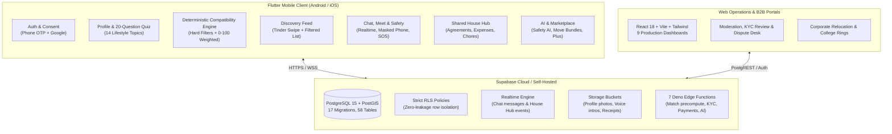

# FlatFit — Compatibility-First Flatmate Matching & Co-Living Platform

**FlatFit** ("Tinder for flatmates") is a full-stack, India-first co-living platform built with Flutter, Supabase (PostgreSQL + PostGIS + RLS), and React/Vite.

---

## 1. System Architecture



---

## 2. Modules Implemented (1 through 16)

| # | Module | Core Implementation | Key Files |
|---|---|---|---|
| **1** | **Auth, Onboarding & Profile** | Phone OTP (+91 verification), Google OAuth, 6-step animated onboarding wizard, profile completion meter, voice/video greeting intros. | [auth_repository.dart](file:///d:/Codestar30/flatfit/lib/features/auth/data/auth_repository.dart)<br/>[onboarding_flow_screen.dart](file:///d:/Codestar30/flatfit/lib/features/profile/presentation/screens/onboarding_flow_screen.dart) |
| **2** | **Lifestyle Questionnaire** | 20 single-tap questions across 14 lifestyle topics in English with Hinglish wording; 3-tier importance tagging (`deal_breaker`, `important`, `nice_to_have`). Neutral lifestyle only. | [questionnaire_data_source.dart](file:///d:/Codestar30/flatfit/lib/features/questionnaire/data/questionnaire_data_source.dart)<br/>[questionnaire_screen.dart](file:///d:/Codestar30/flatfit/lib/features/questionnaire/presentation/screens/questionnaire_screen.dart) |
| **3** | **Compatibility Engine** | Pure function with 3-stage pipeline: Hard filters (budget overlap ≥ 20%, ≤5km Haversine or shared locality, ≤30-day move-in window, bidirectional gender match, deal-breaker conflicts) → 0-100 weighted score → explainable output pills ("Compatible on: X, Y. Watch out: Z"). Pluggable for ML ranking. | [compatibility_engine.dart](file:///d:/Codestar30/flatfit/lib/features/matching/domain/compatibility_engine.dart)<br/>[compatibility_engine_test.dart](file:///d:/Codestar30/flatfit/test/features/matching/domain/compatibility_engine_test.dart) |
| **4** | **Discovery** | Parallax Tinder-style 3-card swipe stack with spring dismiss + scrollable list view; saved searches with alerts; 3-way side-by-side profile compare; 2-4 friend squad group hunting; Mumbai locality transit insights. | [swipe_view_screen.dart](file:///d:/Codestar30/flatfit/lib/features/discovery/presentation/screens/swipe_view_screen.dart)<br/>[compare_screen.dart](file:///d:/Codestar30/flatfit/lib/features/discovery/presentation/screens/compare_screen.dart) |
| **5** | **Chat & Meet** | Realtime 1:1 chat, voice note player with speed control, image sharing, two-party phone number unmasking, AI icebreakers, public neutral cafe meet scheduler, and in-app video call preview. | [chat_screen.dart](file:///d:/Codestar30/flatfit/lib/features/chat/presentation/screens/chat_screen.dart)<br/>[meet_scheduler_screen.dart](file:///d:/Codestar30/flatfit/lib/features/chat/presentation/screens/meet_scheduler_screen.dart) |
| **6** | **Listings** | 6-step listing creator, 0-100 listing quality scorer, interactive Google Maps view with pins, sublet/short-stay flags, roommate profiles display. | [listings_screen.dart](file:///d:/Codestar30/flatfit/lib/features/listings/presentation/screens/listings_screen.dart)<br/>[create_listing_screen.dart](file:///d:/Codestar30/flatfit/lib/features/listings/presentation/screens/create_listing_screen.dart) |
| **7** | **Verification & Trust** | Multi-factor trust scoring (0-100), mock Aadhaar/DigiLocker KYC without storing raw numbers, selfie liveness match, Women-Only Mode filter, floating SOS button with live emergency contacts dispatch. | [verification_center_screen.dart](file:///d:/Codestar30/flatfit/lib/features/verification/presentation/screens/verification_center_screen.dart)<br/>[safety_center_screen.dart](file:///d:/Codestar30/flatfit/lib/features/verification/presentation/screens/safety_center_screen.dart) |
| **8** | **Move-In & Agreements** | Plain-language flatmate house rules builder, legally sound IT Act digital signatures, state-wise rent registration guides (Maharashtra/Karnataka/Delhi), move-in condition checklist. | [agreement_builder_screen.dart](file:///d:/Codestar30/flatfit/lib/features/agreements/presentation/screens/agreement_builder_screen.dart)<br/>[move_in_checklist_screen.dart](file:///d:/Codestar30/flatfit/lib/features/agreements/presentation/screens/move_in_checklist_screen.dart) |
| **9** | **Shared House Hub** | Flat notice board, shared calendar (power cuts, parties, maintenance), shared grocery checklist, exact paise expense splitter, minimum-cash-flow debt simplification, NPCI UPI intent generator (`upi://pay`), fair chore rotation, quiet hours mode. | [house_hub_screen.dart](file:///d:/Codestar30/flatfit/lib/features/hub/presentation/screens/house_hub_screen.dart)<br/>[expense_splitter_test.dart](file:///d:/Codestar30/flatfit/test/features/expenses/domain/expense_splitter_test.dart) |
| **10** | **Replacement & Exit** | Vacancy replacement workflow for early departures, exit inspection checklist, wear-and-tear vs damage calculation, deposit settlement ledger. | [flatmate_replacement_screen.dart](file:///d:/Codestar30/flatfit/lib/features/exit/presentation/screens/flatmate_replacement_screen.dart)<br/>[exit_checklist_screen.dart](file:///d:/Codestar30/flatfit/lib/features/exit/presentation/screens/exit_checklist_screen.dart) |
| **11** | **AI Features** | AI Profile Coach, AI structured interviewer, Conversation Safety AI (scam and off-platform payment detection), Listing Authenticity AI, Conflict Mediator (de-escalating phrasing for house disputes), and strict PII redactor. | [ai_profile_coach.dart](file:///d:/Codestar30/flatfit/lib/features/ai/domain/ai_profile_coach.dart)<br/>[conversation_safety_test.dart](file:///d:/Codestar30/flatfit/test/features/ai/conversation_safety_test.dart) |
| **12** | **Services Marketplace** | 9 service verticals (movers & packers, furniture rental, deep cleaning, maids, cooks, etc.), move-in bundles, 18% GST + 10% platform commission accounting. | [marketplace_screen.dart](file:///d:/Codestar30/flatfit/lib/features/marketplace/presentation/screens/marketplace_screen.dart) |
| **13** | **Community & Growth** | Mumbai locality guides (Bandra, Andheri, Powai, Lower Parel, etc.), new-in-town mixer events, referral invite link generator with 3-friend Plus unlock milestones. | [community_screen.dart](file:///d:/Codestar30/flatfit/lib/features/community/presentation/screens/community_screen.dart) |
| **14** | **Monetization** | FlatFit Plus subscription paywall with feature flag gates (basic matching and first chat are permanently free), verified listing fees, matching concierge requests. | [flatfit_plus_screen.dart](file:///d:/Codestar30/flatfit/lib/features/monetization/presentation/screens/flatfit_plus_screen.dart) |
| **15** | **B2B Web Portals** | Enterprise corporate relocation dashboard, university off-campus housing rings (IIT Bombay, NMIMS, etc.), PG/co-living operator inventory manager with lifestyle habit allocation. | [B2BCorporate.tsx](file:///d:/Codestar30/flatfit-admin/src/pages/B2BCorporate.tsx)<br/>[B2BOperators.tsx](file:///d:/Codestar30/flatfit-admin/src/pages/B2BOperators.tsx) |
| **16** | **Admin Panel & Analytics** | React 18 / Vite / Tailwind web app: 7-stage conversion funnel, retention metrics, user management, moderation queue, dispute arbitration desk, security audit trail. | [Dashboard.tsx](file:///d:/Codestar30/flatfit-admin/src/pages/Dashboard.tsx)<br/>[Moderation.tsx](file:///d:/Codestar30/flatfit-admin/src/pages/Moderation.tsx) |

---

## 3. Database Schema & RLS

All SQL migrations are organized sequentially in [flatfit/supabase/migrations/](file:///d:/Codestar30/flatfit/supabase/migrations/):
- `001_extensions.sql` — `uuid-ossp`, `postgis`, `pg_trgm`
- `002_auth_profiles.sql` — `profiles`, `profile_photos`, `voice_intros`
- `003_questionnaire.sql` — `questions`, `user_answers`
- `004_matching.sql` — `precomputed_matches`, `interests`, `match_outcomes`
- `005_discovery.sql` — `saved_searches`, `shortlists`, `groups`, `group_members`
- `006_chat.sql` — `conversations`, `messages`, `blocked_users`, `reports`
- `007_listings.sql` — `listings`, `listing_photos`, `listing_amenities`
- `008_verification.sql` — `verifications`, `trust_scores`, `reviews`
- `009_agreements.sql` — `agreements`, `agreement_signatures`, `move_in_checklists`
- `010_living.sql` — `flats`, `flat_members`, `expenses`, `expense_splits`, `chores`, `calendar_events`, `notices`, `grocery_items`, `house_inventory`
- `011_payments.sql` — `payments`, `subscriptions`, `feature_flags`
- `012_services.sql` — `service_partners`, `service_bookings`, `service_reviews`
- `013_community.sql` — `city_guides`, `events`, `event_rsvps`, `referrals`, `ambassadors`
- `014_b2b.sql` — `corporate_accounts`, `college_accounts`, `operator_accounts`
- `015_notifications.sql` — `notifications`, `notification_preferences`
- `016_admin.sql` — `admin_users`, `moderation_queue`, `disputes`, `audit_logs`, `analytics_events`
- `017_rls_policies.sql` — **Row Level Security enabled across every single table**

### Demo Dataset
The seed script at [flatfit/supabase/seed/seed.sql](file:///d:/Codestar30/flatfit/supabase/seed/seed.sql) (353 KB) includes:
- **50 realistic users** across Mumbai localities (Andheri West, Bandra West, Powai, Lower Parel, Malad West, Goregaon East, Thane, Vashi)
- Full questionnaire answers across all 14 lifestyle topics
- 15 property listings with amenities and photos
- Sample flat **'Sunshine 301'** with 3 active flatmates, 10 itemized expenses, 5 recurring chores, and shared calendar events

---

## 4. Test Suite Summary

13 comprehensive test suites are located in [flatfit/test/](file:///d:/Codestar30/flatfit/test/):

| Test Suite | Coverage Highlights |
|---|---|
| **Compatibility Engine** | 25 test cases: exact matches, adjacent matches, 20% budget overlap threshold, 5km Haversine distance, move-in window, bidirectional deal-breaker elimination, importance weights. |
| **Expense Splitter** | Equal split, exact paise rounding, custom ratios, O(N) debt simplification, and NPCI UPI URI generation. |
| **Conversation Safety** | Token advance payment scams, QR/UPI phishing blocks, Telegram lure detection. |
| **Listing Authenticity** | Price anomaly detection (e.g., ₹8,000 for 2 BHK in Bandra West flagged). |
| **Conflict Mediator** | Categorization of cleaning and bill disputes into de-escalating constructive rewrites. |
| **Privacy Filter** | Automatic redaction of Aadhaar, PAN, phone numbers, and UPI handles before external AI processing. |
| **Feature Flag Gate** | Gating paid filters while guaranteeing free basic matching and first chat. |

---

## 5. How to Run

### Mobile Application (Flutter)
```bash
cd flatfit
# Ensure .env is populated (see .env.example)
flutter pub get
flutter run
```

### Admin Web Panel (React / Vite)
```bash
cd flatfit-admin
npm install
npm run dev      # Local development server at http://localhost:5173
npm run build    # Production build to dist/
```

### Supabase Backend
```bash
cd flatfit/supabase
# Link and push migrations
supabase link --project-ref <your-project-ref>
supabase db push
# Seed database
supabase db execute --file ./seed/seed.sql
```
